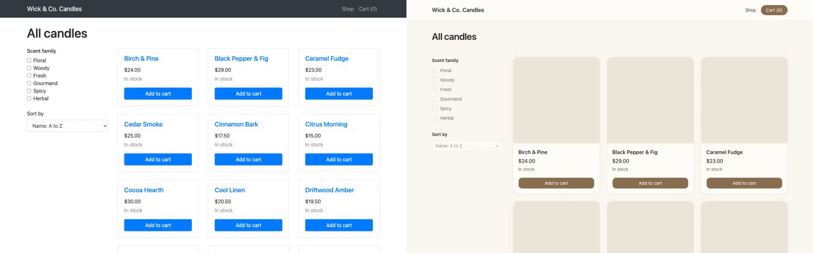
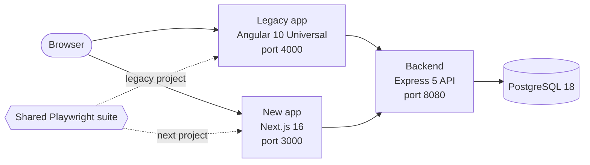

# Wick & Co. Candles: a legacy Angular to Next.js migration

This repository moves a small candle shop from a server rendered Angular 10 app (Angular Universal) to Next.js 16. Both front ends talk to one shared backend, and one Playwright suite runs against both of them, so functional parity is proven by tests rather than assumed. Where the two apps differ, the difference has an ID, an entry in a register and a test on each side. The legacy app is a purpose-built stand-in for a real one: it is written to look and behave like an aging production shop, planted defects included, so the migration has something realistic to preserve and to fix.

## What this proves

- **Same behavior.** The shared suite runs against both apps in CI, on x64 and Arm runners. A test that names no known difference must pass on both apps with the same expectations. Every business rule in [requirements.md](./docs/requirements.md) needs a test in each layer it lists, and CI fails when one is missing.
- **Documented differences.** Every place where the new app behaves differently on purpose is listed in [Known differences](#known-differences), with a shared test that expects the old behavior on legacy and the rule on the new app.
- **Measurable wins.** Lighthouse scores, JavaScript on first load, backend calls per page view, known vulnerabilities, mutation score and line coverage are measured for both apps in the same CI run. CI writes the [Results](#results) table from that run.
- **Safe process.** The suite was green on the legacy app before any new code existed. The new app then took over the shop flow by flow, and each flow's shared tests had to pass on both apps before its step merged. The approach is written up in [docs/migration-approach.md](./docs/migration-approach.md).

## Results

The results table is generated from the comparison pull request's CI run and appears here with the first snapshot.

## Side by side

<table>
  <tr>
    <td colspan="2"></td>
  </tr>
  <tr>
    <td align="center" width="50%">Legacy (Angular 10, port 4000)</td>
    <td align="center" width="50%">New (Next.js, port 3000)</td>
  </tr>
</table>

The recording is made by [`e2e/recording/record.ts`](./e2e/recording/record.ts), which buys the same candle in both apps and lines up each step. Run it with `pnpm --filter e2e record` against a stack started by `pnpm demo:test` (it needs ffmpeg).

## Architecture



Both front ends render pages on the server and call the same backend, so the data and the server side rules are identical, and any difference a test sees comes from the front end. The backend owns the catalog, stock, prices and the fake payment, and rechecks stock and prices when an order is placed. PostgreSQL is not published to the host.

The shared suite in [`e2e/`](./e2e) runs as two Playwright projects: `legacy` against port 4000 and `next` against port 3000. The `next` project runs only the flows listed in `ENABLED_NEXT_FLOWS` in [`e2e/support/flows.ts`](./e2e/support/flows.ts), which now holds all four: shell, browse, cart and checkout. Every test starts from a reset database, through backend endpoints that exist only in test mode.

## Known differences

The legacy app breaks rules from [requirements.md](./docs/requirements.md) in six known ways. Five were planted on purpose, so the migration has real defects to record and to fix. One, KD-06, was not planted: the parity review of the cart rewrite found it. Each one has a shared test that expects the legacy behavior on the legacy app and the rule on the new app, through `byTarget` in [`e2e/support/known-differences.ts`](./e2e/support/known-differences.ts). The full register, with the legacy code and the tests on both sides, is [docs/known-differences.md](./docs/known-differences.md).

- [KD-01](./docs/known-differences.md#kd-01-cart-amounts-lose-a-cent): legacy sums prices as floating point dollars and truncates, so one $16.15 candle shows a $16.14 subtotal. The new app keeps integer cents.
- [KD-02](./docs/known-differences.md#kd-02-not-found-pages-answer-http-200): legacy answers HTTP 200 for an unknown route, product or order. The new app answers 404.
- [KD-03](./docs/known-differences.md#kd-03-a-subtotal-of-exactly-5000-still-pays-shipping): legacy charges shipping on a subtotal of exactly $50.00. The new app ships it free, as the rule says.
- [KD-04](./docs/known-differences.md#kd-04-the-server-rendered-cart-badge-always-shows-0): legacy keeps the cart in `localStorage`, so its server rendered cart badge always shows 0. The new app renders the real count.
- [KD-05](./docs/known-differences.md#kd-05-place-order-stays-enabled-while-the-order-is-submitted): legacy keeps Place order enabled while the order is submitted, so a double click places two orders. The new app places one.
- [KD-06](./docs/known-differences.md#kd-06-the-legacy-cart-caps-edits-by-the-stock-seen-when-the-item-was-added): legacy caps cart edits by the stock seen when the item was added. The new app caps by current stock.

### Known limitations

- The confirmation page is addressed by order number, so anyone holding an order number can view that order. Checkout is guest only with fake data, and an order access token is part of the production rollout stage.
- A failed add to cart during a backend outage shows no message in the new app, because the shared page text defines no message for that case.
- On narrow phones the cart table scrolls sideways inside its card.

## How to run

Prerequisites: Docker with Docker Compose, and Node 24 with pnpm through corepack. The legacy app builds and runs on Node 12 inside its container, so the host never needs Node 12.

```sh
corepack enable
pnpm install
pnpm demo
```

`pnpm demo` builds and starts the stack with Docker Compose: the legacy app on http://localhost:4000, the new app on http://localhost:3000 and the backend on http://localhost:8080. Stop it with Ctrl+C, or with `docker compose down`.

To run the shared suite against both apps:

```sh
pnpm --filter e2e exec playwright install chromium
pnpm e2e
```

On Linux, add `--with-deps` to the install command so it also installs the system libraries Chromium needs.

`pnpm e2e` starts the stack in test mode (`TEST_MODE=true` turns on the backend's test endpoints), waits until every service is healthy, then runs both Playwright projects. The HTML report is written to `e2e/playwright-report/all`.

If a port is taken, move the apps with `LEGACY_PORT`, `WEB_PORT` and `BACKEND_PORT`, and point the suite at the new ports with `LEGACY_URL`, `WEB_URL` and `BACKEND_URL`:

```sh
LEGACY_PORT=4100 WEB_PORT=3100 BACKEND_PORT=8180 pnpm demo

LEGACY_PORT=4100 WEB_PORT=3100 BACKEND_PORT=8180 \
LEGACY_URL=http://localhost:4100 WEB_URL=http://localhost:3100 BACKEND_URL=http://localhost:8180 \
pnpm e2e
```

## Interview demo

Install Chromium for the suite beforehand, as shown in [How to run](#how-to-run).

1. Start the stack with `pnpm demo:test`. It is the same stack as `pnpm demo`, started in the background with the backend's test endpoints turned on, so step 4 reuses it.
2. Open http://localhost:4000 and http://localhost:3000 side by side.
3. Buy the same candle in each. With one Fig & Cassis in the cart, the legacy subtotal is a cent short (KD-01). Check out with card `4242 4242 4242 4242`, any future expiry and any three digit CVC.
4. Run `pnpm e2e`. It finds the stack already up and runs the shared suite against both apps. Each test starts from a reset database, so the demo orders are cleared.
5. Open the live reports at https://ceylan019.github.io/angular-to-next/.
6. Stop the stack with `docker compose down`.

## Reports

CI publishes its reports to GitHub Pages on every push to `main` once the jobs that produce them pass: https://ceylan019.github.io/angular-to-next/

- Playwright reports for both apps, on the `ubuntu-24.04` and `ubuntu-24.04-arm` runners
- Mutation testing reports for the backend, the new app and the legacy app
- Lighthouse reports for both apps
- Coverage reports for both apps

Every CI run also keeps these reports as downloadable artifacts, including runs on pull requests.

## Repository tour

| Path                                         | What it holds                                                                                                                                        |
| -------------------------------------------- | ---------------------------------------------------------------------------------------------------------------------------------------------------- |
| [`legacy/`](./legacy)                        | The Angular 10 Universal shop on Node 12, with Karma and Jasmine unit tests and a report only Stryker run.                                           |
| [`web/`](./web)                              | The Next.js 16 rewrite (App Router, React 19, Tailwind CSS, zod), with Vitest and React Testing Library tests and Stryker.                           |
| [`backend/`](./backend)                      | The shared Express 5 API on PostgreSQL with Drizzle ORM: catalog, orders, the seed catalog, test mode endpoints and the product image generator.     |
| [`e2e/`](./e2e)                              | The shared Playwright suite in `tests/`, its helpers in `support/` and the side by side recorder in `recording/`.                                    |
| [`scripts/`](./scripts)                      | The traceability checker, the metrics and results generators and the reports site builder, with unit tests and mutation testing of their core logic. |
| [`lighthouse/`](./lighthouse)                | Lighthouse CI settings for both apps.                                                                                                                |
| [`docs/`](./docs)                            | Requirements, the known differences register, the legacy tech debt, the generated traceability matrix and the migration approach.                    |
| [`.github/workflows/`](./.github/workflows)  | CI on every pull request and push to `main`, and a nightly flake check that repeats the shared suite.                                                |
| [`docker-compose.yml`](./docker-compose.yml) | The stack: PostgreSQL, the backend, the legacy app and the new app.                                                                                  |

The legacy code level debt that changes no behavior is listed in [docs/tech-debt.md](./docs/tech-debt.md), and [docs/traceability.md](./docs/traceability.md) maps every rule and known difference to its tests in each layer.

## Next stage

The production rollout stage moves real traffic to the new app gradually: a router sends a small canary share to it, monitoring compares its errors, latency and completed orders with the legacy app, and one switch sends all traffic back to legacy at once. It also gives order pages an access token. This stage is tracked as a backlog issue.

## Build history

Each step landed as its own pull request, in this order:

1. Repository skeleton: the workspace, Docker Compose and the CI skeleton.
2. Shared backend: the API, the database schema, the seed catalog and the generated product images.
3. Legacy Angular 10 shop, with its planted defects and its unit tests.
4. Shared parity suite, proven green on the legacy app, with the requirements, the known differences register and the traceability gate.
5. Rewrite browse, with the shell flow: the header and layout, the product list and the detail pages, enabled in the shared suite.
6. Rewrite cart, enabled in the shared suite. Its parity review found KD-06.
7. Rewrite checkout and the order confirmation, enabled in the shared suite.
8. Old versus new results: Lighthouse, metrics, the generated results, the side by side recording and the reports site.

## Credits

Product images are generated by [`backend/scripts/generate-images.ts`](./backend/scripts/generate-images.ts), which draws each candle as an SVG and converts it to JPEG with sharp when the backend container is built.

## License

[MIT](./LICENSE)
